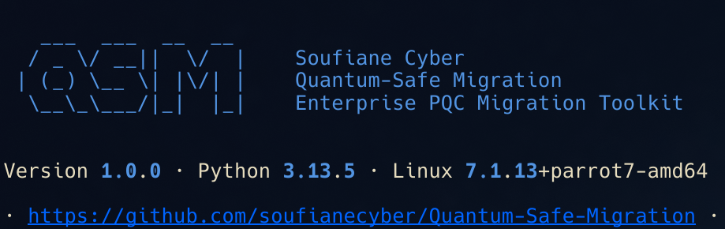
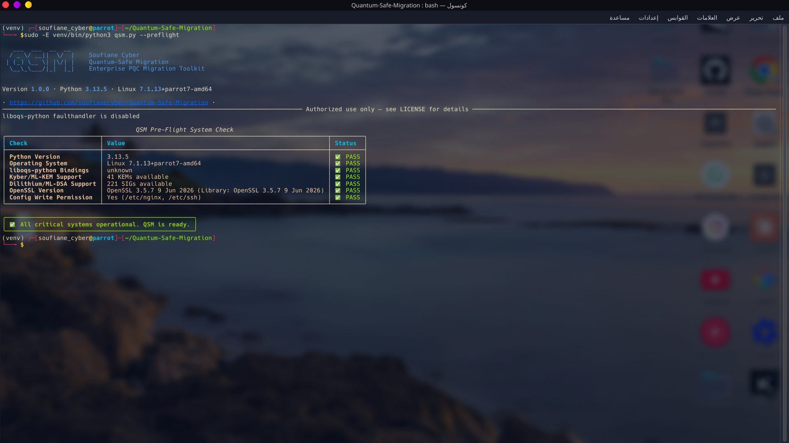
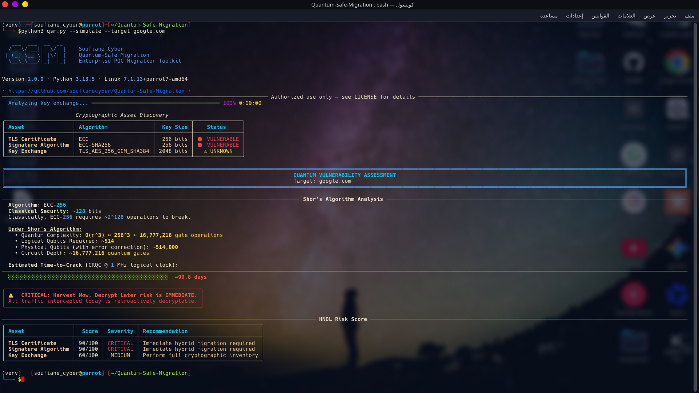
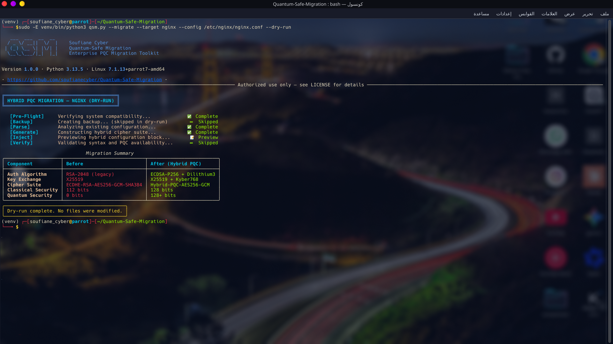

# 🌌 Quantum-Safe Migration (QSM)

<div align="center">
  
</div>

---


---

**A Post-Quantum Cryptography Migration Toolkit for Nginx and OpenSSH.**

---

## 🛠️ Overview

QSM is an open-source toolkit that audits legacy cryptographic configurations
and migrates them to **hybrid post-quantum cryptography (PQC)**. It targets
the **"Harvest Now, Decrypt Later" (HNDL)** threat vector by simulating Shor's
Algorithm impact and automating hybrid migrations on Debian-based systems.

> ⚠️ **Strict Architectural Principle:** QSM **never** permits pure
> post-quantum deployment. All operations enforce a **Hybrid Paradigm**
> combining classical and PQC algorithms (ECDSA P-256 + ML-DSA-65 for
> authentication; X25519 + ML-KEM-768 for key exchange).

---

## ⚠️ Limitations & Honest Disclosure

QSM is a **functional proof-of-concept**, not a certified production tool.
Please read this section carefully before relying on it in critical
environments.

### Simulation Model

The `--simulate` command uses a **simplified analytical model** for Shor's
Algorithm resource estimation — not a compiled quantum circuit:

- Gate count: `O(bits³)`
- Physical qubits: `logical_qubits × 1000` (surface code assumption)
- Logical clock: 1 MHz (conservative)

**This produces order-of-magnitude estimates, not precise predictions.**
Real-world CRQC resource requirements depend on circuit depth, gate fidelity,
error-correction overhead, and hardware architecture. These remain active
research areas.

The output figures (e.g., *"~99 days for ECC-256"*) represent a theoretical
**lower bound under stated assumptions**, not a measurement on any existing
machine. No Cryptographically Relevant Quantum Computer (CRQC) exists today.

### Migration Scope

The `--migrate` command **patches configuration files** to inject hybrid
cipher suites. It **does not**:

- Install or configure `liboqs` or `oqs-provider`
- Generate hybrid certificates
- Verify the target service actually supports the injected algorithm names
- Test the resulting TLS handshake end-to-end

**You must ensure `oqs-provider` is installed and loaded** for the injected
cipher names to be honored. Test all migrations in a non-production
environment first.

### Production Readiness

QSM has been verified on:

- Parrot OS Security · kernel 7.1.13+parrot7-amd64
- Python 3.13.5 · Nginx 1.26.3 · OpenSSL 3.5.7
- Unit tests passing (see `tests/`)

It has **not** been stress-tested at scale, under load, or across diverse
environments. Treat it as a **reference implementation** and adapt it to
your infrastructure.

### NIST Standards Alignment

QSM targets the **finalized NIST standards**:

| FIPS | Algorithm | QSM Usage |
|------|-----------|-----------|
| **FIPS 203** | ML-KEM | Key exchange (`ML-KEM-768`) |
| **FIPS 204** | ML-DSA | Authentication (`ML-DSA-65`) |

> **Terminology:** "Kyber" and "Dilithium" were the pre-standard codenames
> used during the NIST competition. The finalized standards use **ML-KEM**
> and **ML-DSA** respectively. QSM uses the standardized names throughout.

---

## 🚀 Dual Operational Modes

QSM is built to run adaptively across environments:

1. **Lightweight Mode (Simulation & Dry-Run):** Requires zero advanced
   C-dependencies. Simulate Shor's Algorithm attacks, risk scores, and
   preview migration configurations safely.
2. **Production Mode (Active Migration):** Requires `liboqs` system
   integration to patch configuration layers atomically with
   checksum-verified rollback logic.

---

## ⚡ Installation & Quick Start

### 1. Clone and Setup

```bash
# Clone and enter the vault
git clone https://github.com/soufianecyber/Quantum-Safe-Migration
cd Quantum-Safe-Migration

# Initialize virtual environment
python3 -m venv venv
source venv/bin/activate

# Install dependencies
pip install -r requirements.txt
```

### 2. Verify Your Matrix

```bash
python3 qsm.py --preflight
```

---

## 🎮 CLI Reference Guide

```bash
# 1. Run Quantum Attack Simulation on target assets
python3 qsm.py --simulate --target example.com
python3 qsm.py --simulate --keyfile ./test_legacy_key.pem

# 2. Preview Hybrid Migration Block (Safe Dry-Run)
python3 qsm.py --migrate --target nginx --config ./dummy_nginx.conf --dry-run

# 3. Apply Production Migration (Requires Sudo)
sudo venv/bin/python3 qsm.py --migrate --target nginx --config /etc/nginx/nginx.conf
sudo venv/bin/python3 qsm.py --migrate --target sshd --config /etc/ssh/sshd_config

# 4. Atomic Rollback Checksum Restoration
sudo venv/bin/python3 qsm.py --rollback --target /etc/nginx/nginx.conf
```

---

## 📸 Screenshots

### 1. Pre-Flight System Check

```bash
sudo python3 qsm.py --preflight
```



*Validates Python version, liboqs bindings, ML-KEM/ML-DSA availability, and OpenSSL.*

### 2. Quantum Vulnerability Assessment

```bash
python3 qsm.py --simulate --target google.com
```



*Detects ECC-256 on google.com and computes Shor's Algorithm time-to-crack.*

### 3. Hybrid PQC Migration (Dry-Run)

```bash
sudo python3 qsm.py --migrate --target nginx --config /etc/nginx/nginx.conf --dry-run
```



*Preview of hybrid cipher suite injection — no files modified.*

---

## 🛡️ License & Legal Framework

Distributed under the **MIT License**. See `LICENSE` for details.

*Disclaimer: This toolkit is built exclusively for authorized testing and
infrastructure migration verification purposes.*

---

## 👤 Author

**Soufiane Cyber**

- 🐙 GitHub: [github.com/soufianecyber](https://github.com/soufianecyber)
- 🔐 Focus: Offensive Security · Post-Quantum Cryptography · DevSecOps

---

## 🙏 Acknowledgements

- [Open Quantum Safe](https://openquantumsafe.org/) for `liboqs`
- [NIST PQC Project](https://csrc.nist.gov/projects/post-quantum-cryptography) for FIPS 203/204
- [Shields.io](https://shields.io) for badge infrastructure

---

## ⭐ Support the Project

If QSM helps you secure your infrastructure against quantum threats,
please consider giving it a **star** on GitHub. It helps the project
gain visibility and reach more security teams who need it.

[](https://github.com/soufianecyber/Quantum-Safe-Migration/stargazers)